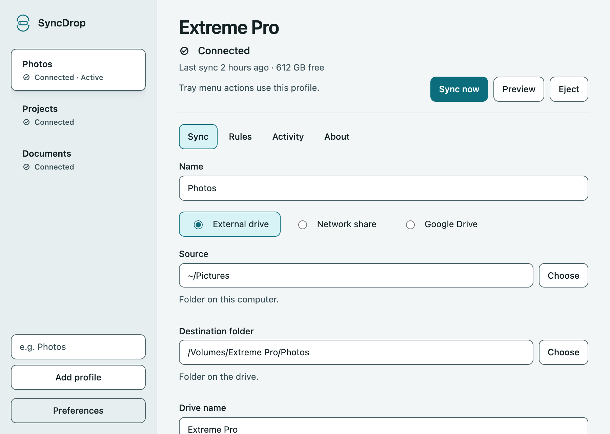
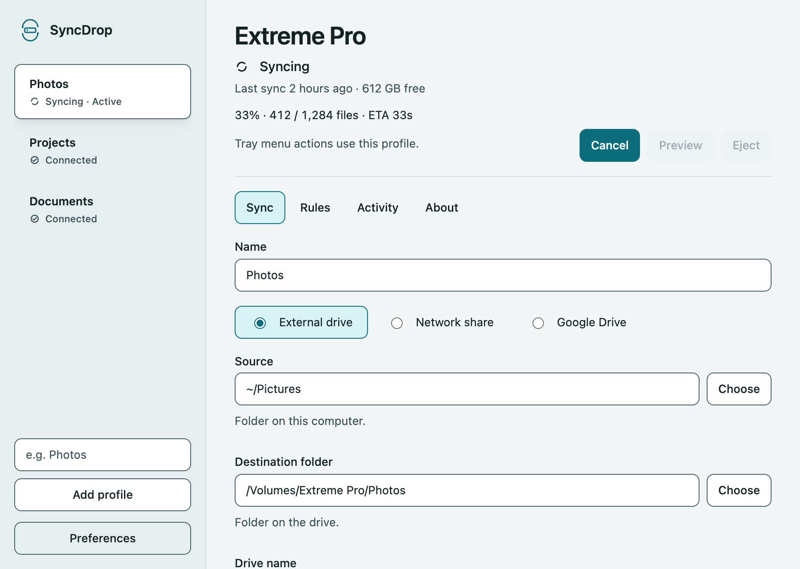
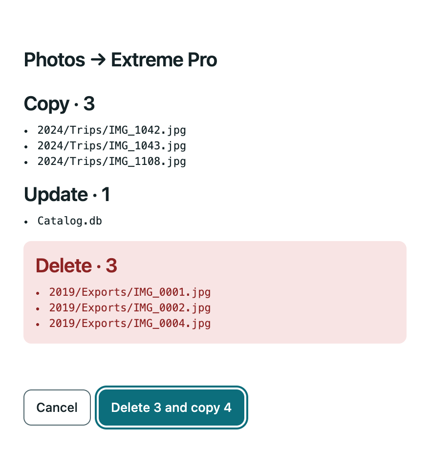
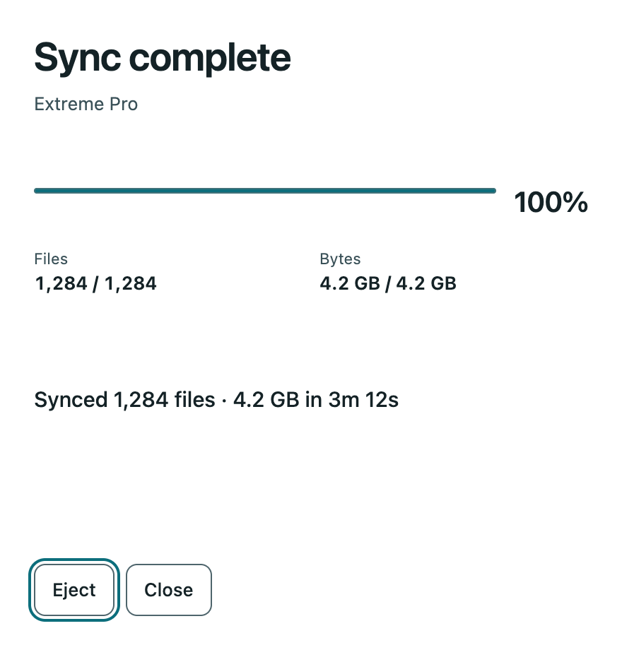
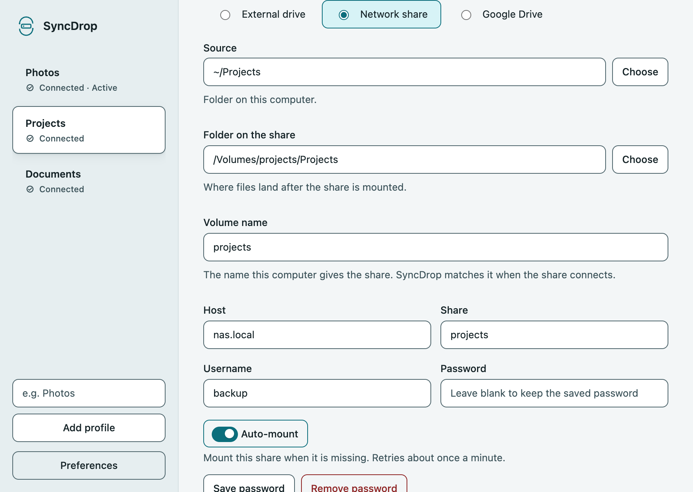
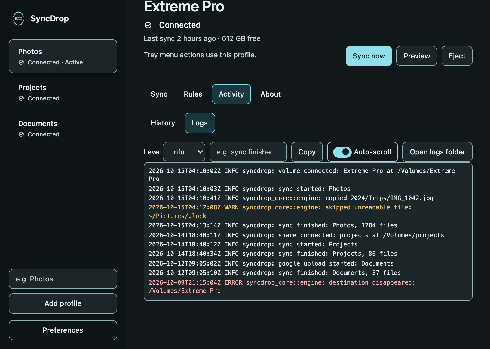

<div align="center">


# SyncDrop

**OneDrive for your own hardware — auto-sync the folders you choose to any drive you plug in, the moment it connects.**

[](https://github.com/abhinay-hat/SyncDrop/releases/latest)
[](LICENSE)
[](#download)

<br>

<picture>
  <source media="(prefers-color-scheme: dark)" srcset="docs/screenshots/hero-dark.png">
  
</picture>

</div>

SyncDrop is a tray app for macOS (menu bar), Windows, and Linux (system tray), plus an Android app. Point a profile at a folder. When the external drive connects, the NAS share mounts, or Google Drive is signed in, that folder syncs.

The desktop copy engine is Rust. It does not shell out to rsync.

## Quick start

1. Add a profile.
2. Pick the target — **External drive**, **Network share**, or **Google Drive** — then the source folder and the destination.
3. Turn on **Auto-sync**.

## Download

Installers for the current release are on **[GitHub Releases](https://github.com/abhinay-hat/SyncDrop/releases/latest)**.

| Platform | File |
|----------|------|
| macOS Apple silicon | [`SyncDrop_0.1.0_aarch64.dmg`](https://github.com/abhinay-hat/SyncDrop/releases/latest/download/SyncDrop_0.1.0_aarch64.dmg) |
| macOS Intel | [`SyncDrop_0.1.0_x64.dmg`](https://github.com/abhinay-hat/SyncDrop/releases/latest/download/SyncDrop_0.1.0_x64.dmg) |
| Windows | [`SyncDrop_0.1.0_x64-setup.exe`](https://github.com/abhinay-hat/SyncDrop/releases/latest/download/SyncDrop_0.1.0_x64-setup.exe) |
| Linux AppImage | [`SyncDrop_0.1.0_amd64.AppImage`](https://github.com/abhinay-hat/SyncDrop/releases/latest/download/SyncDrop_0.1.0_amd64.AppImage) |
| Linux deb | [`SyncDrop_0.1.0_amd64.deb`](https://github.com/abhinay-hat/SyncDrop/releases/latest/download/SyncDrop_0.1.0_amd64.deb) |
| Android | [`SyncDrop-android-v0.1.0.apk`](https://github.com/abhinay-hat/SyncDrop/releases/latest/download/SyncDrop-android-v0.1.0.apk) |


**Install notes**

- **macOS unsigned:** right-click the app → **Open**, or run `xattr -dr com.apple.quarantine` on it.
- **Windows SmartScreen:** **More info > Run anyway**.
- **Linux AppImage:** `chmod +x` the file before launching it.

## Features

| Feature | What it does |
|---------|--------------|
| **Auto-sync on connect** | Each profile can start a sync when its drive or share connects. |
| **Multiple profiles** | Each profile has its own source, target, and rules, and is watched on its own. |
| **Preview** | Preview lists copies, updates, and deletes. Exact mirror always previews before it writes and shows the delete count. Google Drive has no local preview; Sync now uploads changed files. |
| **Copy or Exact mirror** | Copy adds and updates. Exact mirror also deletes destination files that are not in the source. |
| **Versions** | With Keep versions on, replaced and deleted files move to `.syncdrop-versions/<YYYY-MM-DD_HHMMSS>/` on the destination. |
| **Exclude globs** | Skip names such as `.DS_Store` and `node_modules`. |
| **Network share** | SMB host, share, and username. Auto-mount retries about once a minute. The password stays in the OS keychain. |
| **Google Drive** | OAuth upload with your own client id. Create a Desktop OAuth client, enable the Drive API, paste the redirect URI, then save the client id and secret and sign in. Secret and tokens stay in the keychain. [Google Cloud credentials](https://console.cloud.google.com/apis/credentials). |
| **Auto-eject** | After a successful sync, eject the drive. The popup then says **Safe to unplug**. |
| **History and logs** | Recent runs in the Activity tab. Daily log files (prefix `syncdrop`, seven kept) live in the logs directory below. |
| **Notifications** | Optional system notification when a sync finishes. |
| **Launch at login** | Start SyncDrop when you sign in. |
| **Shortcuts** | Cmd on macOS, Ctrl elsewhere: **S** save, **R** sync now, **.** cancel, **,** preferences. |
| **Dark mode** | Follows the system appearance. |
| **exFAT-safe copies** | Copies file contents only (no owner or permission bits) and treats timestamps within one second as equal. A file is replaced by writing a temp file and renaming it into place. |

## Screenshots

| Syncing | Preview |
|---------|---------|
|  |  |
| **Sync complete** | **Network share** |
|  |  |
| **Activity** | |
|  | |

## Build from source

Rust and `tauri-cli` ^2. On Linux: `sudo apt-get install -y libwebkit2gtk-4.1-dev libayatana-appindicator3-dev librsvg2-dev patchelf`. Windows needs WebView2.

```bash
make desktop-run    # cargo run -p syncdrop
make desktop-test   # cargo test in desktop/
make desktop        # cargo tauri build in desktop/app
```

Android:

```bash
cd android && ./gradlew :app:assembleDebug
```

## Where data lives

`config.json` is `dirs::config_dir()/SyncDrop/config.json`. Logs are `dirs::data_local_dir()/SyncDrop/logs/` (`dirs` 6).

| | config.json | logs |
|--|-------------|------|
| macOS | `~/Library/Application Support/SyncDrop/config.json` | `~/Library/Application Support/SyncDrop/logs/` |
| Windows | `%APPDATA%\SyncDrop\config.json` | `%LOCALAPPDATA%\SyncDrop\logs\` |
| Linux | `$XDG_CONFIG_HOME/SyncDrop/config.json` or `~/.config/SyncDrop/config.json` | `$XDG_DATA_HOME/SyncDrop/logs/` or `~/.local/share/SyncDrop/logs/` |

## Project layout

```
desktop/core/    # syncdrop-core: profiles, config, copy engine, volumes, NAS, Google Drive
desktop/app/     # Tauri 2 tray app and ui/
android/         # Jetpack Compose app (USB OTG, Room, WorkManager)
```

## Roadmap

- Signed and notarized release builds by default
- Auto-update
- More cloud targets
- Share the Rust core with the Android app

## Contributing

Issues and pull requests welcome. Run `make desktop-test` before submitting. `make desktop` produces the Tauri bundles (`cargo tauri build`).

### Releasing (maintainers)

```bash
make desktop    # Tauri bundles under desktop/target/release/bundle/
```

To ship a **notarized** macOS build, set `APPLE_SIGNING_IDENTITY` so Tauri signs during the build, then notarize:

```bash
export APPLE_SIGNING_IDENTITY="Developer ID Application: Your Name (TEAMID)"
export APP_STORE_CONNECT_KEY_ID=...        # App Store Connect API key id
export APP_STORE_CONNECT_ISSUER_ID=...     # issuer id
export APP_STORE_CONNECT_API_KEY_P8="$(cat AuthKey_XXXX.p8)"
./Scripts/sign-and-notarize.sh   # builds, notarizes, staples, zips
```

See [`Scripts/sign-and-notarize.sh`](Scripts/sign-and-notarize.sh).

#### Automated releases (GitHub Actions)

`make release` prints the tag and push commands. Pushing a `v*` tag triggers [`.github/workflows/release.yml`](.github/workflows/release.yml), which builds desktop installers and the Android debug APK and attaches them to a GitHub Release. 

```bash
make release
git tag v0.1.0 && git push origin v0.1.0
```

If these repo **secrets** are set, macOS builds are signed (and notarized when the Apple ID secrets are present). When they are absent, the build is unsigned:

| Secret | What |
|--------|------|
| `APPLE_CERTIFICATE` | Developer ID certificate, `.p12` base64-encoded |
| `APPLE_CERTIFICATE_PASSWORD` | password for that `.p12` |
| `APPLE_SIGNING_IDENTITY` | `Developer ID Application: Your Name (TEAMID)` |
| `APPLE_ID` | Apple ID used for notarization |
| `APPLE_PASSWORD` | app-specific password |
| `APPLE_TEAM_ID` | Apple Developer Team ID |

## License

[MIT](LICENSE) © 2026 Abhinay Reddy
